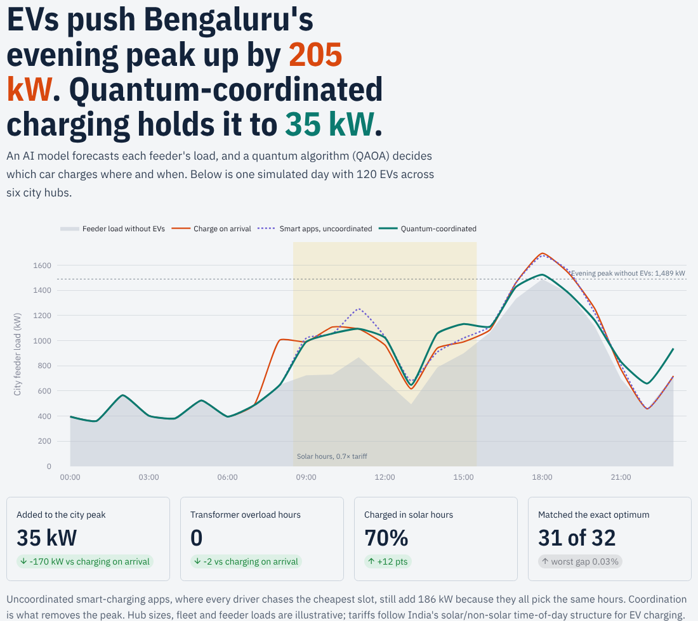
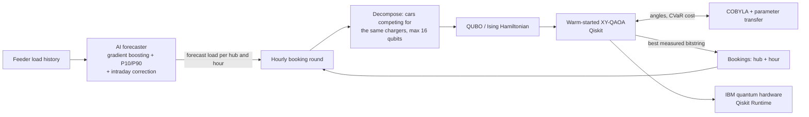
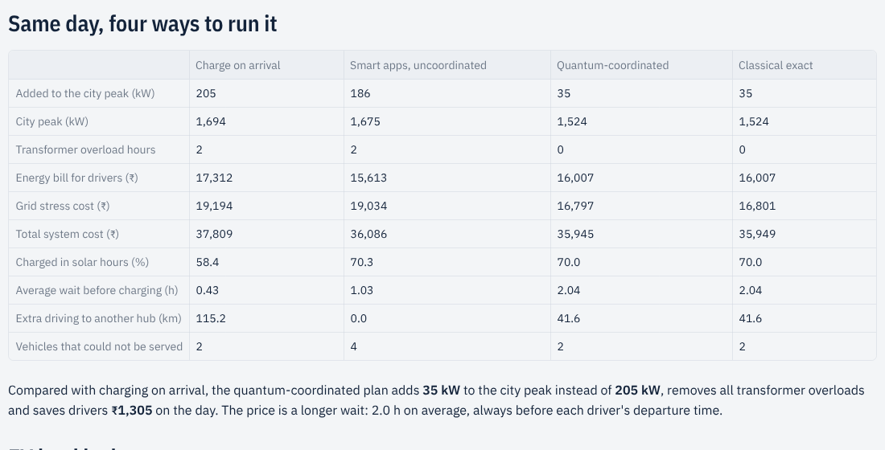
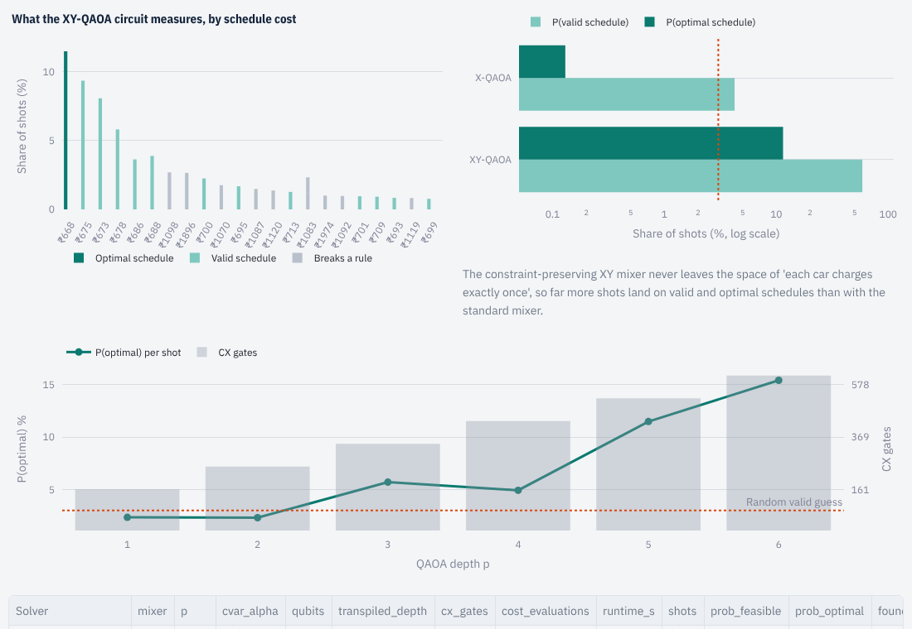
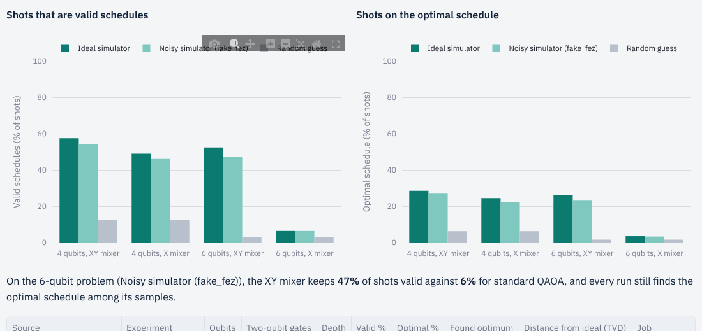
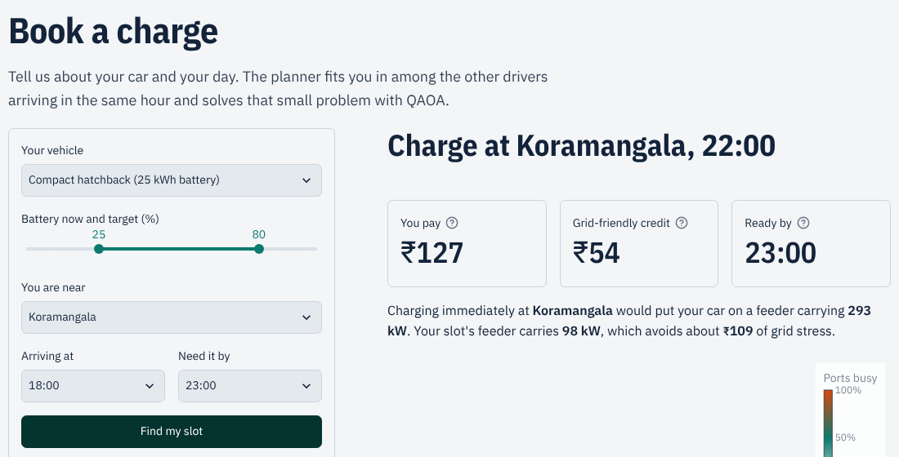

# Quantum EV Charging Optimizer

**Hybrid quantum + AI scheduling of electric-vehicle charging across a city.**
An AI model forecasts the load on each grid feeder, and a variational quantum algorithm (QAOA, built on Qiskit) decides **which vehicle charges, at which hub and when**. The goal is to charge every car on time without creating new grid peaks.

Submission for **QHack 2026**.

[](https://ev-quantum-charging.streamlit.app/)
[](https://github.com/MinalVP0824/EV-Quantum-Charging/actions/workflows/tests.yml)

**Live demo:** https://ev-quantum-charging.streamlit.app/



## Highlights

| | |
|---|---|
| **City-scale digital twin** | A full day in Bengaluru: 120 EVs, 6 hubs, 24 hourly re-plans. Uncontrolled charging adds **205 kW** to the evening peak. Quantum-coordinated charging adds **35 kW** and removes every transformer overload. |
| **Quantum on the problem it can handle** | The city problem is decomposed into **32 sub-problems of at most 16 qubits**. XY-QAOA matches the brute-force optimum in **31 of 32**; the other is within 0.03%. |
| **Constraint-preserving QAOA** | A W-state start and an XY mixer keep "each car charges exactly once" true for every state the circuit can reach: **14x more valid shots** and **88x more optimal shots** than standard QAOA at the same depth. |
| **Warm start + parameter transfer** | Angles trained on one sub-problem start the next: **443 → 50 circuit runs** per sub-problem with the same answer quality. |
| **Real IBM quantum hardware** | Run on **ibm_fez**, a 156-qubit IBM Heron processor, with error mitigation. On the 6-qubit problem the XY mixer keeps **32.6%** of shots valid against **5.8%** for standard QAOA, and hits the optimal schedule **10x more often than random guessing**. Every hardware run found the optimum. |
| **Book a charge** | A driver enters car, battery and times. The planner fits them in among the drivers arriving the same hour, re-solves that sub-problem with QAOA in about 3 seconds, and shows the slot, the price and a proposed grid-friendly credit. |

## 1. The problem

EV adoption is growing faster than local grid capacity.

* **Grid stress:** cars plug in when drivers get home, on top of the evening household peak, and overload feeders and transformers.
* **Herding:** price-aware charging apps make it worse in a new way. Every driver's app picks the same cheap hour, so the peak just moves.
* **Congestion:** drivers pile into the same hubs while others sit idle.

Deciding which car charges where and when is a combinatorial problem: with `V` vehicles, `S` hubs and `T` slots there are up to `(S·T)^V` schedules. It maps naturally onto qubits and an Ising Hamiltonian, which is what QAOA and quantum annealers target.

## 2. How it works



1. **Forecast.** A gradient-boosting model predicts each feeder's load for the next day with a P10 to P90 band. Every hour the forecast is corrected with the latest measurement. Held-out error: **2.34 kW MAE**, 29% better than "same hour yesterday".
2. **Decompose.** Each hour, the cars that just arrived are grouped by which chargers and hours they compete for. Each group has at most 4 cars with their 4 best options, so every sub-problem fits in **16 qubits or fewer**.
3. **Solve with QAOA.** Each sub-problem becomes a QUBO. The forecast enters as a coefficient of the Hamiltonian through the grid-stress term, so the prediction reshapes the energy landscape QAOA explores.
4. **Book.** The best valid measured schedule becomes real bookings. Later hours see those bookings, exactly like a reservation system.

## 3. Formulation

Decision variable: `x[v,s,t] = 1` if vehicle `v` charges at hub `s` in hour `t`.

```
cost(v,s,t) = τ_t·E_v                                  energy bill (time-of-day tariff)
            + γ·[(d̂_{s,t} + L_{s,t} + E_v)² − (d̂_{s,t} + L_{s,t})²]   grid stress on the hub's feeder
            + w·(t − arrival_v)                         waiting
            + 2·c_km·distance(preferred hub, s)         detour

H = Σ cost(v,s,t)·x[v,s,t]
  + Σ_{same hub and hour} 2γ·E_v·E_v'·x[v,s,t]·x[v',s,t]     exact coupling between cars on one feeder
  + B·Σ_{last free port} x[v,s,t]·x[v',s,t]                  one car per port
  (+ A·Σ_v (1 − Σ x[v,·,·])²  only for standard QAOA; the XY mixer enforces it by construction)
```

`d̂` is the AI forecast, `L` is load already booked. Tariff: **0.7× in solar hours (09:00 to 16:00), 1.3× otherwise**, following the structure of India's EV charging guidelines as adopted by KSERC in 2025, on an illustrative ₹7/kWh base.

## 4. Quantum algorithm

| Component | Choice | Why |
|---|---|---|
| Initial state | One W state per vehicle, or a **warm-start** state biased towards each car's cheapest option | Starts inside the space of valid schedules, near a good answer |
| Cost layer | `RZ` and `RZZ` from the Ising coefficients | Standard QAOA phase separator |
| Mixer | XY ring (`XX+YY` gates) inside each vehicle's block | Moves a car between its options without ever breaking the one-hot rule (Hadfield et al., 2019) |
| Objective | CVaR at alpha = 0.25 | Trains on the best outcomes, which is what a sampler returns (Barkoutsos et al., 2020) |
| Optimizer | Grid search, then COBYLA; depth grown with INTERP; **parameter transfer** between sub-problems | Good angles for similar Hamiltonians carry over (Galda et al., 2021) |
| Execution | Qiskit `StatevectorSampler` locally; `SamplerV2` on IBM hardware with dynamical decoupling and twirling | Best valid measured bitstring becomes the booking |

A small vectorised simulator applies exactly the same gates during training. The real Qiskit circuit is then simulated and compared: the fidelity is 1.0 to machine precision, and a test enforces it.

## 5. Results

### City day (120 EVs, 6 Bengaluru hubs, 24 hours)



| | Charge on arrival | Smart apps, uncoordinated | **Quantum-coordinated** | Classical exact (reference) |
|---|---|---|---|---|
| Added to the city peak | 205 kW | 186 kW | **35 kW** | 35 kW |
| Transformer overload hours | 2 | 2 | **0** | 0 |
| Energy bill for drivers | ₹17,312 | ₹15,613 | **₹16,007** | ₹16,007 |
| Total system cost | ₹37,809 | ₹36,086 | **₹35,945** | ₹35,949 |
| Charged in solar hours | 58% | 70% | **70%** | 70% |
| Average wait | 0.4 h | 1.0 h | 2.0 h | 2.0 h |

Coordination, not price signals alone, is what removes the peak. Uncoordinated smart apps cut the drivers' bill but still pile everyone into the same hours. The trade-off is a longer wait, always before each driver's departure time.

### Quantum Lab (one 15-qubit sub-problem)



| XY-QAOA, p = 5 | X-QAOA, p = 5 | Random valid guess |
|---|---|---|
| 58.8% valid, **11.5% optimal** per shot | 4.2% valid, 0.13% optimal | 3.0% optimal |

### Hardware: ideal simulator vs IBM noise model vs real IBM quantum computer



Real-device results are from **ibm_fez** (156-qubit IBM Heron r2), 4,096 shots per circuit, with dynamical decoupling and Pauli twirling. The noise model is IBM's `FakeFez`.

| Circuit | 2-qubit gates | Valid shots: ideal / noise model / **ibm_fez** | Optimal shots: ideal / noise model / **ibm_fez** | Random guess (optimal) | Optimum found on hardware |
|---|---|---|---|---|---|
| 4 qubits, XY mixer | 16 | 57.5% / 54.4% / **50.8%** | 28.5% / 27.3% / **24.7%** | 6.3% | yes |
| 4 qubits, X mixer | 11 | 49.0% / 46.1% / **43.9%** | 24.4% / 22.4% / **21.5%** | 6.3% | yes |
| 6 qubits, XY mixer | 27 | 52.3% / 47.4% / **32.6%** | 26.3% / 23.5% / **15.9%** | 1.6% | yes |
| 6 qubits, X mixer | 18 | 6.4% / 6.4% / **5.8%** | 3.5% / 3.3% / **2.7%** | 1.6% | yes |

On real hardware the constraint-preserving XY mixer still puts **5.6x more shots on valid schedules** and **5.9x more on the optimal schedule** than standard QAOA. Noise costs the 6-qubit XY circuit more than the noise model predicts (it has the most two-qubit gates), which is exactly why the city problem is decomposed into small sub-problems.

### Book a charge



## 6. Repository structure

```
EV-Quantum-Charging/
├── app.py                         Streamlit entry point (top navigation)
├── ui/                            pages: overview, city day, booking, quantum lab, hardware, about
│   ├── charts.py                  Plotly chart builders
│   └── style.py                   colours, fonts, helpers
├── evq/
│   ├── city.py                    city digital twin, decomposition, strategies, booking
│   ├── qaoa.py                    QAOA circuits, XY mixer, warm start, parameter transfer
│   ├── hardware.py                IBM hardware / noisy-simulator runs and analysis
│   ├── forecast.py                demand forecaster (P10 / P50 / P90)
│   ├── problem.py                 single-instance QUBO used by the Quantum Lab
│   ├── baselines.py               FCFS, brute force, simulated annealing
│   ├── pipeline.py, serialize.py  end-to-end run and JSON export
│   └── data.py, viz.py            synthetic load, matplotlib figures
├── hardware/run_ibm.py            run the circuits on a real IBM quantum computer
├── scripts/precompute.py          regenerates everything the app shows on first load
├── notebooks/                     walkthrough notebook with runnable circuits
├── results/precomputed/           city day and lab results (JSON)
├── results/hardware/              noisy-simulator and IBM hardware results (JSON)
├── static/fonts/                  IBM Plex (SIL Open Font License), bundled
├── tests/                         11 tests, run on every push by GitHub Actions
└── .streamlit/config.toml         theme
```

## 7. Setup

Requires **Python 3.10 or newer** (3.12 recommended).

```bash
git clone https://github.com/MinalVP0824/EV-Quantum-Charging.git
cd EV-Quantum-Charging
python -m venv .venv
# Windows: .venv\Scripts\activate    macOS / Linux: source .venv/bin/activate
pip install -r requirements.txt
python -m pytest -q
streamlit run app.py
```

## 8. Running on IBM quantum hardware

1. Create a free account at [quantum.cloud.ibm.com](https://quantum.cloud.ibm.com) and an instance on the Open Plan.
2. Copy your API key and instance CRN, then:

```bash
python hardware/run_ibm.py --save-account --token YOUR_API_KEY --instance YOUR_CRN
python hardware/run_ibm.py                    # least busy device, waits for the result
python hardware/run_ibm.py --submit-only      # or submit now ...
python hardware/run_ibm.py --retrieve JOB_ID  # ... and collect later
python hardware/run_ibm.py --fake FakeFez     # noisy simulation, no account needed
```

3. Commit the new file in `results/hardware/` and push. The Hardware page shows it automatically.

## 9. Regenerating results

```bash
python scripts/precompute.py        # city day, quantum lab, noisy simulator (about 3 minutes)
python run_pipeline.py              # single-instance pipeline with matplotlib figures
```

## 10. Limitations

* Sub-problems are at most 16 qubits. At that size a classical solver is faster, so we do **not** claim quantum advantage. The contribution is a complete hybrid pipeline, decomposed to fit today's hardware and structured to grow with it.
* Every session is one hour; partial and multi-hour sessions are not modelled yet.
* Hub sizes, the fleet and feeder loads are simulated around real Bengaluru locations. The optimiser accepts real data without code changes.
* Real-hardware runs use 4 and 6 qubit circuits at depth p = 1 because deeper circuits are still dominated by noise; the 6-qubit XY circuit already loses about a third of its valid shots to noise on ibm_fez.

## 11. Roadmap

1. Multi-hour sessions and vehicle-to-grid discharge at peaks.
2. Larger sub-problems on hardware with error mitigation; quantum annealing on the same QUBO.
3. Real session data and live feeder measurements from a partner charge-point operator.
4. A driver app with booking, reminders and the grid-friendly credit.

## 12. References

* E. Farhi, J. Goldstone, S. Gutmann, *A Quantum Approximate Optimization Algorithm*, 2014.
* S. Hadfield et al., *From the Quantum Approximate Optimization Algorithm to a Quantum Alternating Operator Ansatz*, Algorithms 12(2), 2019.
* P. Barkoutsos et al., *Improving Variational Quantum Optimization using CVaR*, Quantum 4, 256, 2020.
* L. Zhou et al., *Quantum Approximate Optimization Algorithm: Performance, Mechanism, and Implementation on Near-Term Devices*, PRX 10, 021067, 2020.
* D. Egger, J. Mareček, S. Woerner, *Warm-starting quantum optimization*, Quantum 5, 479, 2021.
* A. Galda et al., *Transferability of optimal QAOA parameters between random graphs*, IEEE QCE, 2021.
* A. Lucas, *Ising formulations of many NP problems*, Frontiers in Physics 2, 2014.
* Central Electricity Authority, *CO2 Baseline Database for the Indian Power Sector*, FY 2023-24 grid emission factor (0.727 tCO2/MWh).

## Team

* Minal Venkatesha Poppur, CMR Institute of Technology
* Dalavai Vaishnavi, CMR Institute of Technology
* Shreesha S, CMR Institute of Technology
* Upasana S

## License

MIT. Bundled IBM Plex fonts are under the SIL Open Font License.
